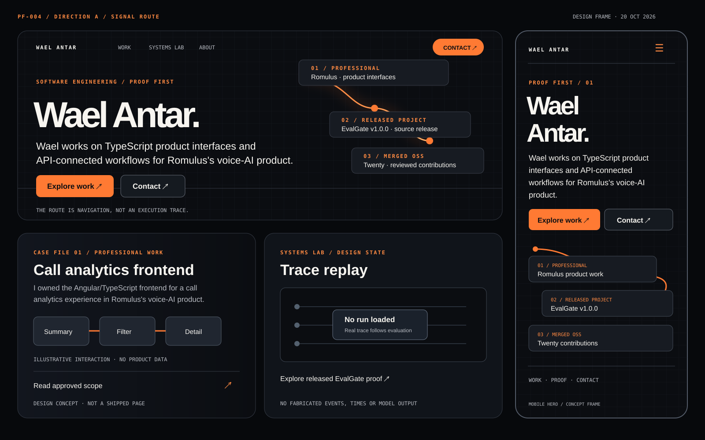
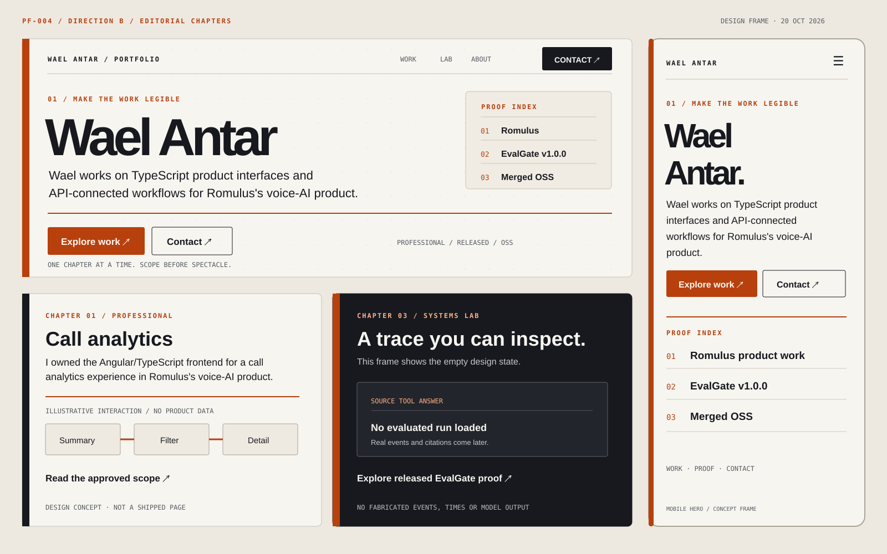
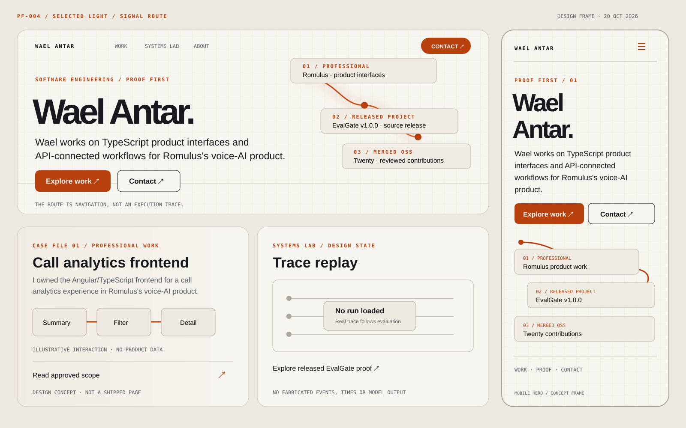

# PF-004 art direction review

**20 October 2026. State: direction selected by Wael.** These are original, static design frames for a future portfolio. They are not a running site, an employer screen, a released case study, or a recorded agent trace.

## Two directions

### A — Signal Route

The orange line connects three distinct kinds of evidence: professional product work, a released personal source project, and merged open-source contributions. It is a navigation device, never a claim about an agent's actual execution. The first view keeps name, approved professional scope, proof categories and contact visible. The grid is restrained so the route carries the motion.

### B — Editorial Chapters

A warm paper surface, bold type and numbered chapters make the story feel deliberate. The proof index puts professional, personal and open-source work in a compact order. This direction is quieter and easier to scan, with the same first-view content and contact action. Its warm palette and editorial type treatment are the selected light-theme reference; its separate chapter layout is not the selected site structure.

**Selected implementation direction:** Wael chose A's route-led structure with B's warm light-theme treatment on 20 October 2026. Use one semantic page structure and the same content order, proof nodes and contact placement in both themes. Switch palette, surface texture and text treatment through theme tokens; do not build a separate chapter layout for light mode.

### Selected light companion

This third frame applies B's warm colour treatment to A's actual structure. It makes the chosen pair directly reviewable: the route, proof order, case-study panel, empty Lab state and contact placement remain in the same positions across themes.

## Shared content and boundaries

- The hero repeats the exact short sentence approved in PF-001. The case-study sketch repeats only the first sentence of the exact paragraph approved in PF-003. EvalGate is labelled a v1.0.0 **source release** and Twenty is labelled **merged OSS**. No personal backend or agent production tenure is implied.
- The case-study interaction sketch is original and generic: summary, filter, detail. It contains no employer logo, screenshot, internal architecture, real value or customer data. It is a concept inside a mood frame, not a final case-study asset.
- The Systems Lab shows an explicit **no run loaded** state. Source/tool/answer words mark future interface slots; there are no invented events, timings, citations or model responses. The eventual trace player must use evaluated real runs.
- Explore and Contact are visual actions in these frames. PF-008 must make them real, keyboard-accessible links. Use a verified contact destination; do not ship a dead button.
- These SVGs use system fonts and code-native shapes only. They import no external image, font, script, analytics or service.

## Design tokens to carry into PF-006

| Role | Dark direction | Light direction |
| --- | --- | --- |
| Page surface | Ink #0B0D11 | Warm paper #F7F5F0 |
| Primary text | #F7F5F0 | Ink #17191F |
| Main accent | #FF7A33 | Deep orange #B8400D |
| Secondary surface | #171B22 | #EFEAE1 |
| Body face | Large system sans; no downloaded font required | Same typography scale and reading order |
| Utility face | Monospace for labels, IDs and time only | Same restrained use |

Calculated token-pair contrast is 17.85:1 for dark primary text, 16.13:1 for light primary text, 8.30:1 for the dark orange label, 5.10:1 for the light orange label, and 5.35:1 for light-theme button text. These are starting tokens. PF-006 must measure actual text, borders, focus indicators and component states in both themes; the artboards are not an accessibility certification.

## Motion and reduced-motion storyboard

| Moment | Normal motion | Reduced motion / no JavaScript |
| --- | --- | --- |
| First paint | Name, approved scope, proof labels and contact are already visible. | Same complete content, immediately. |
| Hero entrance | The selected route draws **once** over about 0.9 seconds after text is visible in either theme. No looping glow or parallax. | Show the finished route with no transition. |
| Deliberate action | Card focus, hover or tap moves emphasis to the next proof item in 0.18–0.24 seconds. Use a visible keyboard focus ring and the same labels on touch. | Change emphasis immediately; preserve focus and label. |
| Case-study reading | A short line can guide eye order from ownership to decision to validation. Never delay the text itself. | Text and diagram are static and readable. |
| Systems Lab | The current state stays empty. Later, only a genuine approved trace may drive status, tool, source and failure states; playback is user controlled. | Use a complete text equivalent and controls that do not require animation. |
| Idle | Stop motion. No scroll lock, custom cursor, autoplay audio or persistent particles. | No motion. |

## Acceptance review and next implementation

The two explorations and the selected light companion were opened in a local browser at 1600 × 1000; each includes a 390-pixel mobile hero. The SVG source was parsed as XML and inspected visually for clipping and legibility. This is a composition review, not a functional mobile, keyboard or screen-reader test; those belong to PF-006/PF-008 and the built preview.

Wael selected the blend above on 20 October 2026, completing PF-004's direction check. PF-005 may scaffold the static site and PF-006 may implement the shared structure, themes, responsive layout and motion fallback. The exact page and any external preview still need their own publication review.
